# Отчёт по модулям 2–4 проекта «ФормаДесерт»

Документ содержит результаты выполнения заданий 2.2, 2.3, 3.2–3.4 и 4.2–4.4,
блок-схемы алгоритмов, описание сообщений и обработки ошибок, а также протокол
ручной проверки приложения.

## 1. Общие сведения

| Параметр | Значение |
| --- | --- |
| Название приложения | «ФормаДесерт» |
| Компания-заказчик | «ФормаДесерт» |
| Язык и версия | Python 3.13+ |
| GUI-фреймворк | PySide6 6.8+ |
| СУБД | PostgreSQL 18.6 |
| Драйвер | psycopg 3.2+ |
| Сборка | PyInstaller 6.11+ |
| Проверочная дата расчёта скидки | 20.10.2026 |
| Предыдущий календарный месяц | сентябрь 2026 |
| База данных | `formadessert`, схема `public` |

Приложение развивает один проект последовательно: каталог модуля 2, оформление
заказа модуля 3 и управление заказами модуля 4. Все данные хранятся в
PostgreSQL; приложение не использует локальные файлы как источник каталога или
заказов.

---

## 2. Модуль 2

### 2.1. Блок-схемы алгоритмов

#### Алгоритм расчёта цены и подготовки строки каталога

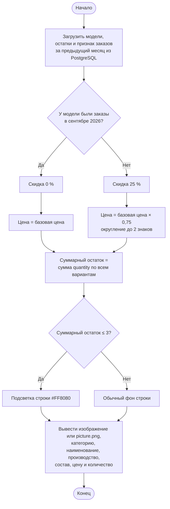

Реализация: `app/services/catalog_service.py` (`_apply_discount`,
`filter_products`), `app/db/catalog_repository.py` (`fetch_products`),
`app/ui/widgets.py` (`ProductRow`).

#### Алгоритм оформления заказа клиентом

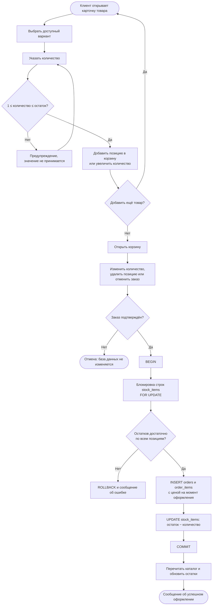

Реализация: `app/services/order_service.py` (`Cart`, `OrderService`),
`app/db/order_repository.py` (`create_order`).

### 2.2. Структура проекта и название приложения

Название приложения — **«ФормаДесерт»** — включает наименование
компании-заказчика. Оно используется в заголовке главного окна, заголовках
страниц, названии исполняемого файла `FormaDessert.exe` и в логотипе.

Файлы распределены по папкам по назначению:

| Папка / файл | Назначение |
| --- | --- |
| `app/main.py` | создание `QApplication`, подключение к БД, запуск окна |
| `app/config.py` | пути к ресурсам, проверочная дата, настройки PostgreSQL |
| `app/errors.py` | доменные исключения (`ValidationError`, `StockError`, `NotFoundError`, `DatabaseUnavailableError`) |
| `app/models/` | dataclass-модели предметной области |
| `app/db/` | подключение и репозитории: пользователи, каталог, заказы |
| `app/services/` | бизнес-логика: скидка, поиск, корзина, транзакции заказов |
| `app/ui/` | страницы PySide6, общие виджеты, стили и диалоги |
| `db/database.sql` | структура БД и демонстрационные данные |
| `resources/` | изображения товаров, логотип, иконка, CSV-источники |
| `scripts/` | подготовка БД, запуск, сборка PyInstaller |
| `docs/` | ER-диаграмма, отчёт, скриншоты |
| `main.py` | точка входа для PyInstaller |

Проверка: структура видна в файловом менеджере и в репозитории; приложение
запускается командами `python -m app.main` и `dist\FormaDessert\FormaDessert.exe`.

### 2.3. Именование исходного кода

Выбранное соглашение — **PEP 8**:

* классы — `CamelCase`;
* функции, методы, переменные и модули — `snake_case`;
* константы — `UPPER_SNAKE_CASE`;
* имена отражают назначение; в одной строке — не более одной команды.

Примеры имён:

| Категория | Примеры |
| --- | --- |
| Классы | `MainWindow`, `CatalogPage`, `ProductPage`, `CartPage`, `OrdersPage`, `OrderDetailPage`, `OrderFormPage`, `OrderEditPage`, `HeaderBar`, `ProductRow`, `CatalogService`, `OrderService`, `Cart`, `Database`, `CatalogRepository`, `OrderRepository` |
| Методы | `load_products`, `get_product`, `filter_products`, `_apply_discount`, `create_order`, `delete_order`, `update_order`, `list_orders`, `set_quantity`, `_on_variant_changed`, `_refresh_cart`, `_reload_catalog` |
| Переменные | `product_id`, `stock_item_id`, `final_price`, `reference_date`, `delete_item_ids`, `selected_stock_item_id`, `available_variants` |
| Модули | `catalog_page.py`, `order_repository.py`, `main_window.py`, `catalog_service.py` |
| Константы | `DISCOUNT_REFERENCE_DATE`, `DISCOUNT_PERCENT`, `ALL_CATEGORIES`, `SORT_PRICE_ASC` |

Пример оформления кода (одна команда в строке, понятные имена):

```python
discount = 0 if product.has_orders_previous_month else self._discount_percent
multiplier = Decimal(100 - discount) / Decimal(100)
final_price = (product.base_price * multiplier).quantize(
    Decimal("0.01"),
    rounding=ROUND_HALF_UP,
)
return replace(
    product,
    discount_percent=discount,
    final_price=final_price,
)
```

Нарушений соглашений в исходном коде не выявлено: имена модулей и методов
записаны в `snake_case`, имена классов — в `CamelCase`, «магические числа»
заменены константами в `app/config.py`.

---

## 3. Модуль 3

### 3.1. Последовательность экранов

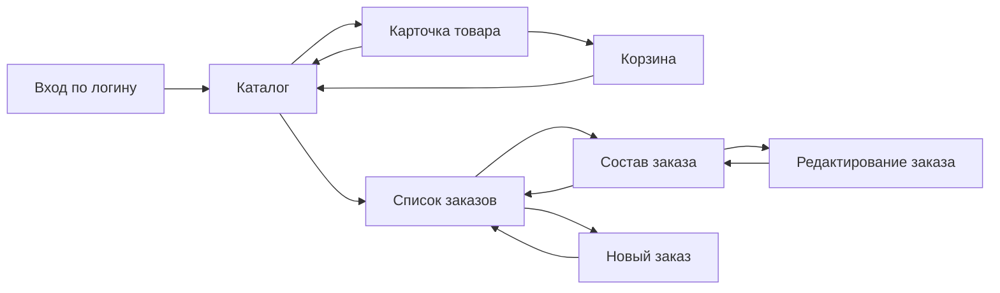

Переходы выполняются через `QStackedWidget`; история страниц хранится в
`MainWindow._history`, кнопки «Назад» возвращают на предыдущий экран.
Заголовок окна и шапки обновляется при каждом переходе.

### 3.2. Сообщения обратной связи

Сообщения реализованы в `app/ui/messages.py` на основе `QMessageBox` с
разными пиктограммами и заголовками:

| Тип | Пиктограмма | Заголовок (пример) | Текст (пример) |
| --- | --- | --- | --- |
| Информация | `Information` | «Заказ оформлен» | «Заказ №19 успешно сохранён. Доступное количество товаров в каталоге обновлено.» |
| Информация | `Information` | «Позиция добавлена» | Наименование, вариант, количество и подсказка открыть корзину |
| Предупреждение | `Warning` | «Пользователь не найден» | Логин отсутствует в списке; предложены примеры `admin`, `manager`, `client1` |
| Предупреждение | `Warning` | «Пустой заказ» | Нельзя подтвердить заказ без позиций; нужно добавить товар |
| Предупреждение | `Warning` | «Товар недоступен» | Не выбран доступный вариант; выбрать вариант из списка |
| Ошибка | `Critical` | «Доступ запрещён» | Работа с заказами доступна только менеджеру и администратору |
| Ошибка | `Critical` | «Непредвиденная ошибка» | Операция не выполнена, приложение продолжает работу; техническая информация |
| Вопрос | `Question` | «Удаление заказа» | Удалить заказ вместе с составом? Товары вернутся на склад |
| Вопрос | `Question` | «Подтверждение заказа» | Оформить заказ на сумму …? Остатки уменьшатся |

Файлы, где используются сообщения: `login_page.py`, `product_page.py`,
`cart_page.py`, `orders_page.py`, `order_edit_page.py`, `main_window.py`.

Проверка: при неверном логине появляется предупреждение с заголовком и
пиктограммой; при удалении заказа — вопрос с кнопками «Да»/«Нет»; отмена не
изменяет данные.

### 3.3. Обработка ошибок и исключений

Ошибки обрабатываются на трёх уровнях:

1. **Интерфейс.** `QSpinBox` ограничивает количество диапазоном
   `1…доступный остаток`, `QComboBox` содержит только доступные варианты,
   `QDateTimeEdit` не позволяет ввести некорректную дату. Кнопки
   блокируются, если действие невозможно.
2. **Бизнес-логика.** `Cart.add` и `Cart.set_quantity` проверяют
   положительность количества и остаток; `OrderService.create_order`
   отклоняет пустой заказ; репозиторий заказов проверяет существование
   позиций и остатки под блокировкой `FOR UPDATE`.
3. **База данных и приложение.** `Database` преобразует ошибки psycopg в
   `DatabaseUnavailableError` / `DatabaseError`, выполняет `rollback`;
   `app/main.py` перехватывает ошибку подключения при старте, а
   `sys.excepthook` не даёт необработанному исключению закрыть приложение.

Протокол проверки ошибок:

| № | Сценарий | Ожидаемый результат | Фактический результат |
| --- | --- | --- | --- |
| 1 | Вход по логину `nobody` | Предупреждение «Пользователь не найден», остаёмся на странице входа | Предупреждение показано, приложение работает |
| 2 | Гость нажимает «Добавить в заказ» | Сообщение о необходимости входа; заказ не создаётся | Кнопка скрыта для гостя, при вызове — предупреждение |
| 3 | Количество 0 или отрицательное | Значение не принимается; подсказка о диапазоне | `QSpinBox` не позволяет ввести значение меньше 1; `Cart` дополнительно raises `ValidationError` |
| 4 | Количество больше остатка | Предупреждение с доступным количеством, позиция не добавляется | `StockError`: «доступно N шт., уменьшите количество» |
| 5 | Подтверждение пустого заказа | Предупреждение, заказ не сохраняется | `ValidationError`, данные не изменены |
| 6 | Менеджер пытается редактировать заказ | Кнопка «Изменить» отсутствует; прямой вызов отклоняется | Кнопка скрыта, `MainWindow` проверяет роль |
| 7 | Удаление заказа, нажата «Отмена» | Заказ и остатки не изменяются | Данные не изменены |
| 8 | Удаление заказа, подтверждение | Заказ удалён, остатки возвращены, список обновлён | Остатки восстановлены, список перечитан из БД |
| 9 | Остановлен сервер PostgreSQL при запуске | Понятное сообщение, аварийного завершения нет | `DatabaseUnavailableError` с параметрами подключения и рекомендациями |
| 10 | Потеря соединения во время работы | Сообщение, следующая операция пытается переподключиться | Соединение закрывается, выполняется повторное подключение |
| 11 | Открытие уже удалённого заказа | Сообщение «Заказ не найден», возврат к списку | `NotFoundError`, список обновляется |

Дополнительно выполнена автоматическая проверка слоя данных: 24 модели,
48 складских позиций, 18 заказов, суммарный остаток 261; создание, удаление и
редактирование заказа не оставляют частично выполненных операций.

### 3.4. Комментарии к исходному коду

Комментарии добавлены только к неочевидным фрагментам и объясняют причины
решений, а не повторяют команды:

| Файл | Фрагмент | Что поясняет комментарий |
| --- | --- | --- |
| `app/services/catalog_service.py` | `_apply_discount` | почему предыдущий месяц — сентябрь 2026 и почему базовая цена в БД не меняется |
| `app/db/order_repository.py` | модульный docstring, `create_order` | зачем все операции выполняются в одной транзакции и зачем `FOR UPDATE` |
| `app/db/connection.py` | `_handle_error` | почему при `OperationalError` соединение закрывается для переподключения |
| `app/ui/catalog_page.py` | `_render_rows` | зачем строка сразу отсоединяется через `setParent(None)` |
| `app/ui/main_window.py` | `_save_order_edit`, `_confirm_new_order` | почему из истории убирается промежуточная страница |
| `app/ui/order_form_page.py` | `_fill_products` | почему выбирается первый товар с ненулевым остатком |

Пример:

```python
# Блокируем строки остатков, чтобы два пользователя не списали
# одно и то же количество одновременно.
cursor.execute(
    """
    SELECT stock_item_id, quantity
    FROM stock_items
    WHERE stock_item_id = ANY(%s)
    FOR UPDATE
    """,
    (stock_item_ids,),
)
```

---

## 4. Модуль 4

### 4.1. Алгоритмы управления заказами

#### Создание заказа менеджером

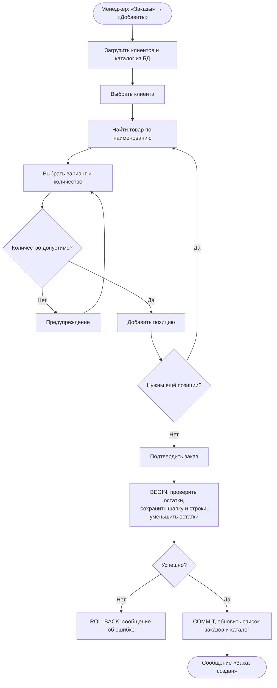

#### Удаление и редактирование заказа

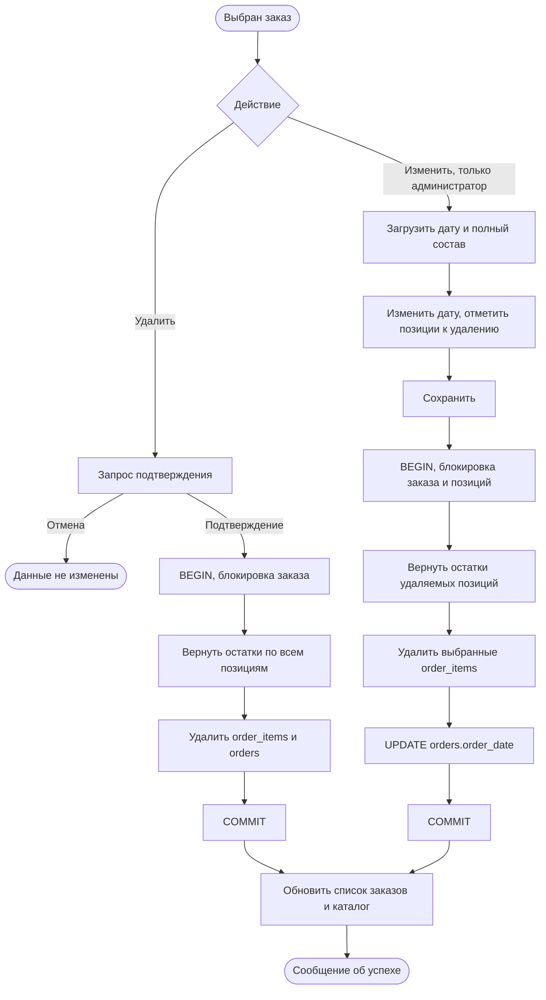

Реализация: `app/db/order_repository.py` (`create_order`, `delete_order`,
`update_order`), `app/ui/orders_page.py`, `order_detail_page.py`,
`order_form_page.py`, `order_edit_page.py`.

### 4.2. Файлы проекта в репозитории

В локальном Git-репозитории размещены:

| Результат | Путь |
| --- | --- |
| Исходный код приложения | `app/`, `main.py` |
| Файлы интерфейса (PySide6-страницы, стили) | `app/ui/` |
| Файлы конфигурации | `app/config.py`, `requirements.txt`, `.env.example` |
| Ресурсы | `resources/` (изображения, логотип, иконка, CSV) |
| ER-диаграмма в PDF | `docs/ER_diagram.pdf` |
| SQL-скрипт создания БД с данными | `db/database.sql` |
| README | `README.md` |
| Документация и скриншоты | `docs/report.md`, `docs/screenshots/` |
| Исполняемый файл PyInstaller | `dist/FormaDessert/FormaDessert.exe` и зависимости |
| Скрипты подготовки и сборки | `scripts/setup_db.ps1`, `scripts/run.ps1`, `scripts/build_exe.ps1` |

Архивов ZIP/RAR внутри репозитория нет. История изменений ведётся Git;
команды проверки:

```powershell
git log --oneline --stat
git status
```

### 4.3. Актуальный исходный код

Актуальная версия — рабочее дерево проекта и последний коммит ветки `master`
(или `main`). Исходный код представлен структурой папок, а не архивом.
Проверка актуальности:

```powershell
git log -1
git diff HEAD
python -m app.main
```

Приложение запускается по инструкции README; для сборки используется
`scripts/build_exe.ps1`, результат — `dist/FormaDessert/FormaDessert.exe`.

### 4.4. Документация README

Файл `README.md` сохранён в UTF-8, разделы оформлены Markdown. Обязательные
сведения:

| Требование | Раздел README |
| --- | --- |
| Название приложения с «ФормаДесерт» | заголовок «ФормаДесерт — приложение магазина кондитерских принадлежностей» |
| Технологии: язык, фреймворк, СУБД | раздел «Используемые технологии» |
| Назначение и функции: каталог, заказы, управление | раздел «Назначение и основные функции» |
| Подготовка БД и запуск | разделы «Подготовка базы данных», «Настройка подключения», «Запуск приложения» |
| Версии зависимостей | `requirements.txt`, таблица версий |
| Настройка подключения без секретов | переменные `PGHOST`…`PGPASSWORD`, `.env.example`, `.gitignore` |
| Путь к SQL-скрипту | `db/database.sql` |
| Логины ролей | таблица `admin`, `manager`, `client1`…`client6` |
| Дата расчёта скидки | 20.10.2026, раздел о модуле 2 |
| Проверочные сценарии | раздел «Проверочные сценарии» |

---

## 5. Протокол ручной проверки

| № | Проверка | Ожидание | Результат |
| --- | --- | --- | --- |
| 1 | Запуск приложения | Открывается страница входа, заголовок «ФормаДесерт — вход в систему» | Выполнено |
| 2 | Вход `client1` | Каталог, ФИО в правом верхнем углу | Выполнено |
| 3 | Каталог: 24 модели | Изображение/заглушка, категория, наименование, производство, состав, цена, количество | Выполнено |
| 4 | Скидка | 12 моделей без заказов за сентябрь 2026 имеют скидку 25 % | Выполнено: модели 1, 2, 6, 8, 12, 14, 18, 20, 21, 22, 23, 24 |
| 5 | Цена со скидкой | Модель 1: 750,00 → 562,50 ₽ | Выполнено |
| 6 | Без скидки | Модель 5: 950,00 ₽ | Выполнено |
| 7 | Подсветка остатка ≤ 3 | Модели 1 (0 шт.) и 2 (3 шт.) светло-красные, модель 3 (4 шт.) — нет | Выполнено |
| 8 | Поиск | Поиск по наименованию и описанию без учёта регистра, в реальном времени | Выполнено |
| 9 | Фильтр | «Все категории» первой строкой; фильтр по категории | Выполнено |
| 10 | Сортировка | По возрастанию и убыванию цены, сохраняется при поиске/фильтре | Выполнено |
| 11 | Карточка товара | Варианты, остатки, описание, цена со скидкой | Выполнено |
| 12 | Добавление в корзину | Накопление одинакового варианта, проверка остатка | Выполнено |
| 13 | Изменение и удаление позиции | Количество меняется, позиция удаляется, итог пересчитывается | Выполнено |
| 14 | Подтверждение заказа | Заказ сохранён, остатки уменьшены, каталог обновлён | Выполнено |
| 15 | Пустой заказ | Предупреждение, заказ не создан | Выполнено |
| 16 | Список заказов менеджера | Дата, ФИО клиента, сумма; кнопка «Изменить» отсутствует | Выполнено |
| 17 | Состав заказа | Модель, производство, вариант, количество, цена, итог | Выполнено |
| 18 | Создание заказа менеджером | Поиск товара, выбор клиента, несколько позиций, сохранение | Выполнено |
| 19 | Удаление заказа | Подтверждение, возврат остатков, обновление списка | Выполнено |
| 20 | Редактирование администратором | Изменение даты и удаление позиций, возврат остатков | Выполнено |
| 21 | Ограничение прав | Менеджер не видит «Изменить», прямой вызов запрещён | Выполнено |
| 22 | Ошибка подключения к БД | Сообщение с параметрами, без аварийного завершения | Выполнено |

Автоматическая проверка слоя данных (PostgreSQL 18.6, тестовая БД на порту
5544): `auth ok`, `catalog ok`, `filters ok`, `create order ok`,
`delete order ok`, `stock validation ok`, `edit order ok`, `orders list ok`.

---

## 6. Скриншоты

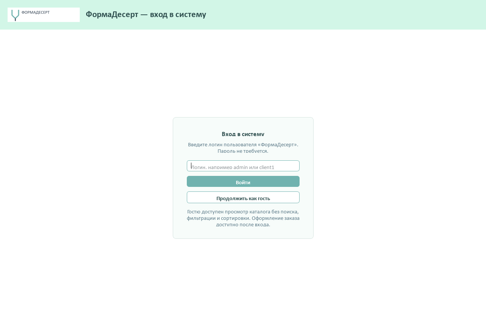

*Рисунок 1. Вход по логину без пароля.*

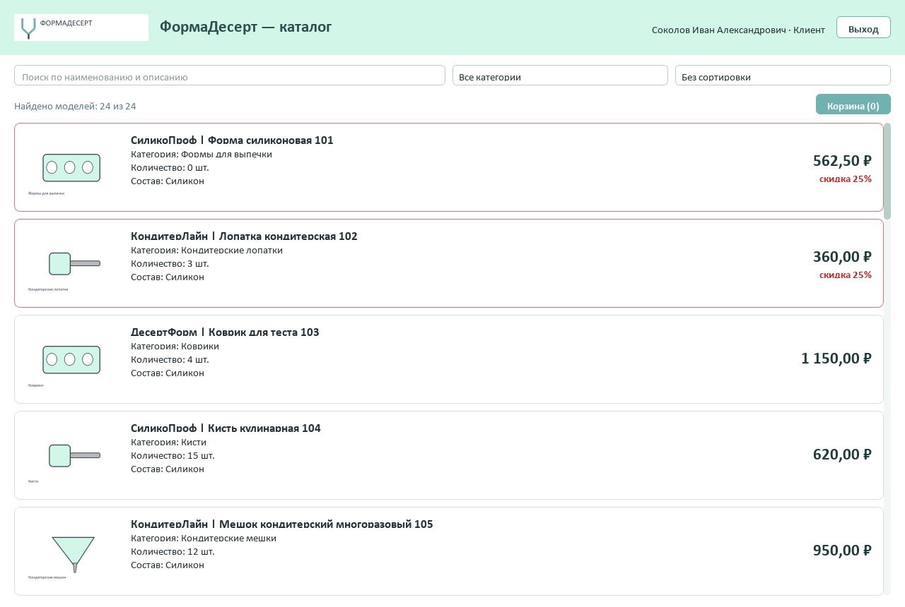

*Рисунок 2. Каталог: подсветка остатка ≤ 3 и скидка 25 %.*

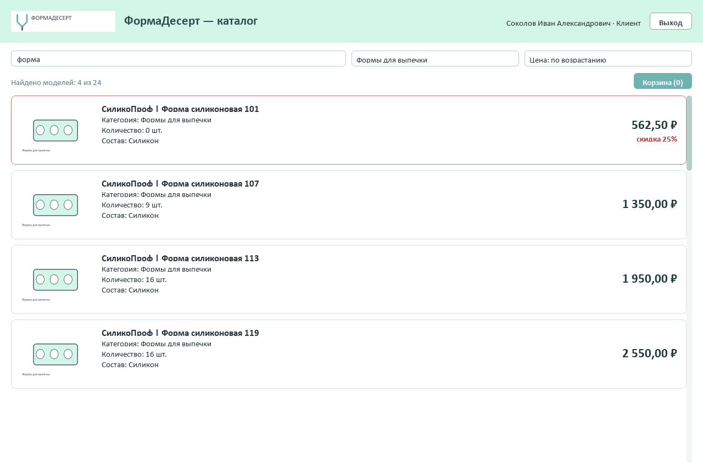

*Рисунок 3. Совместная работа поиска, фильтра и сортировки.*

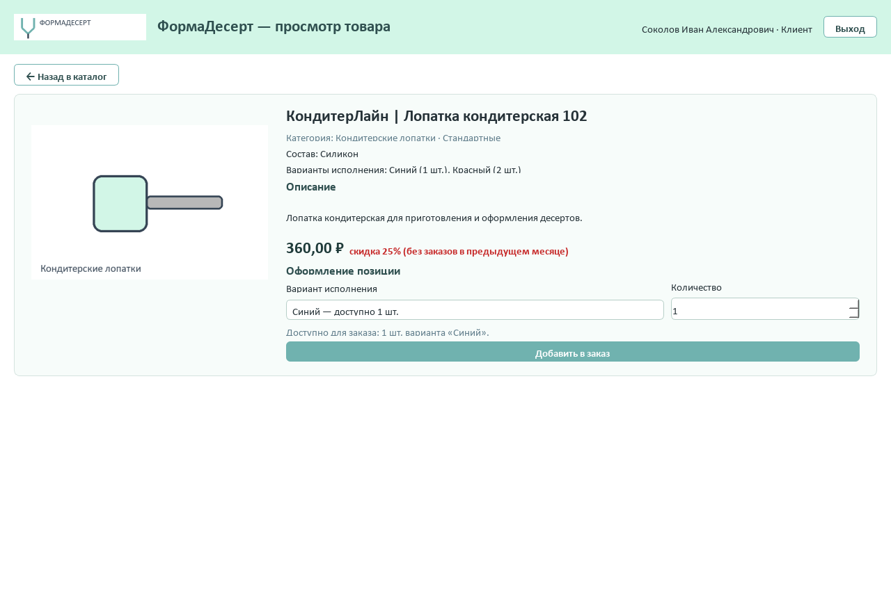

*Рисунок 4. Карточка модели с выбором варианта и количества.*

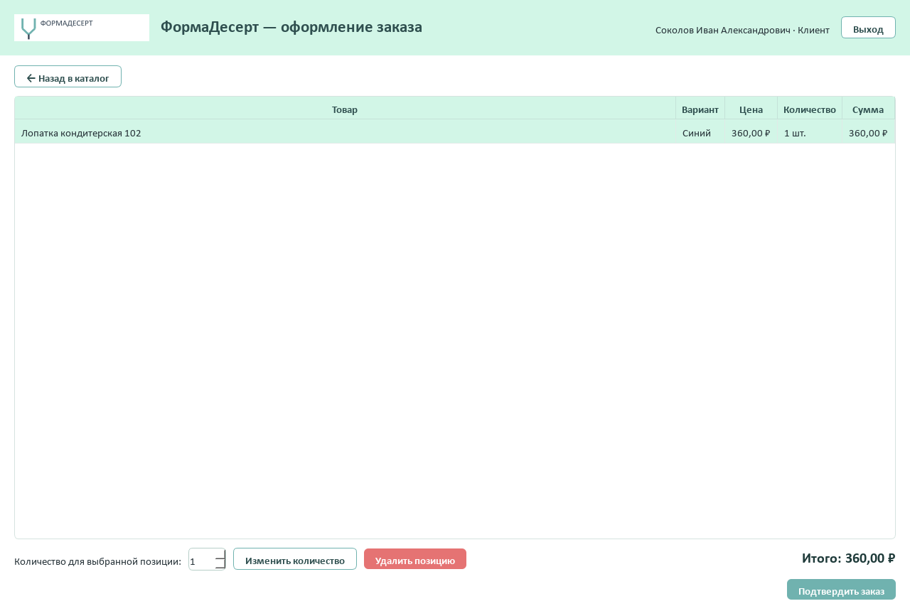

*Рисунок 5. Корзина до подтверждения заказа.*

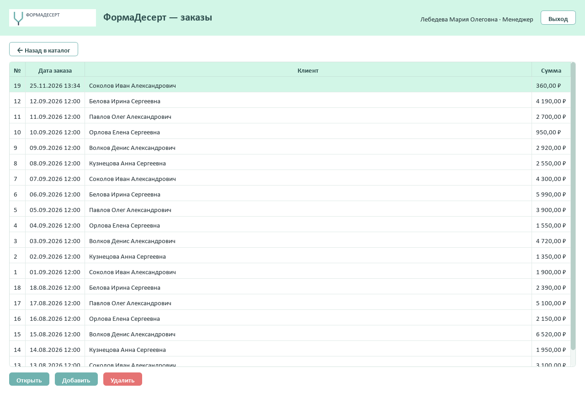

*Рисунок 6. Список заказов менеджера.*

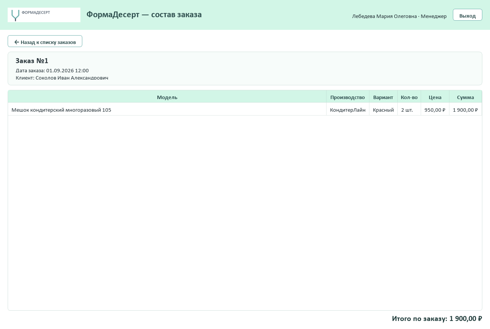

*Рисунок 7. Состав заказа и итоговая сумма.*

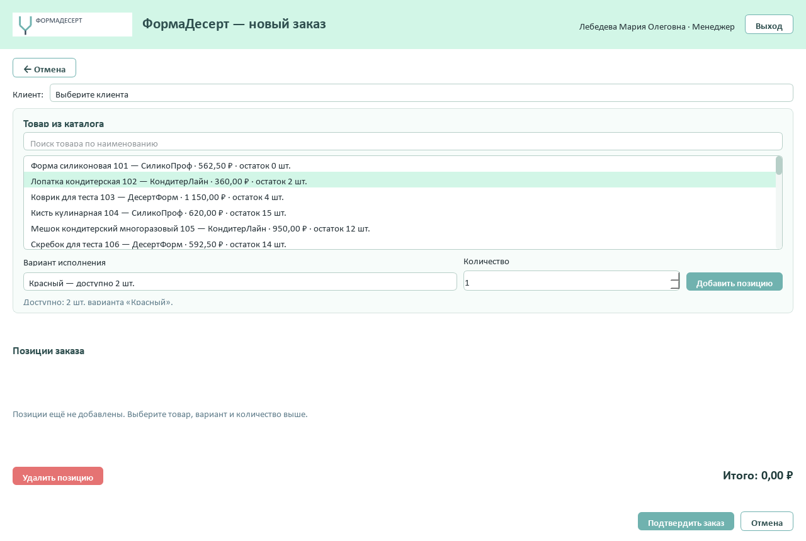

*Рисунок 8. Создание заказа с поиском товара.*

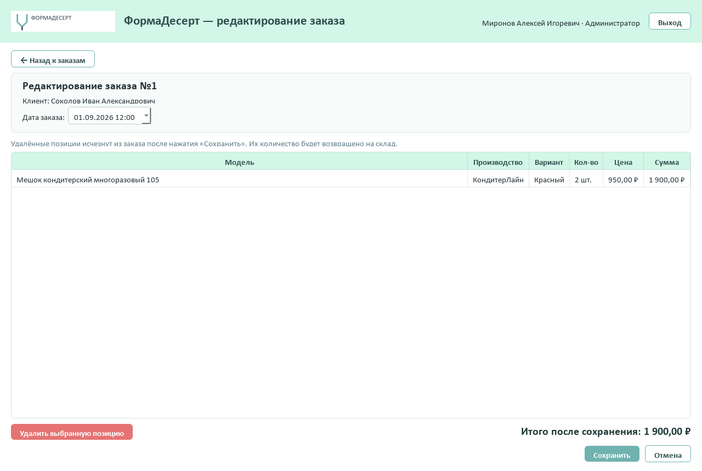

*Рисунок 9. Редактирование заказа администратором.*

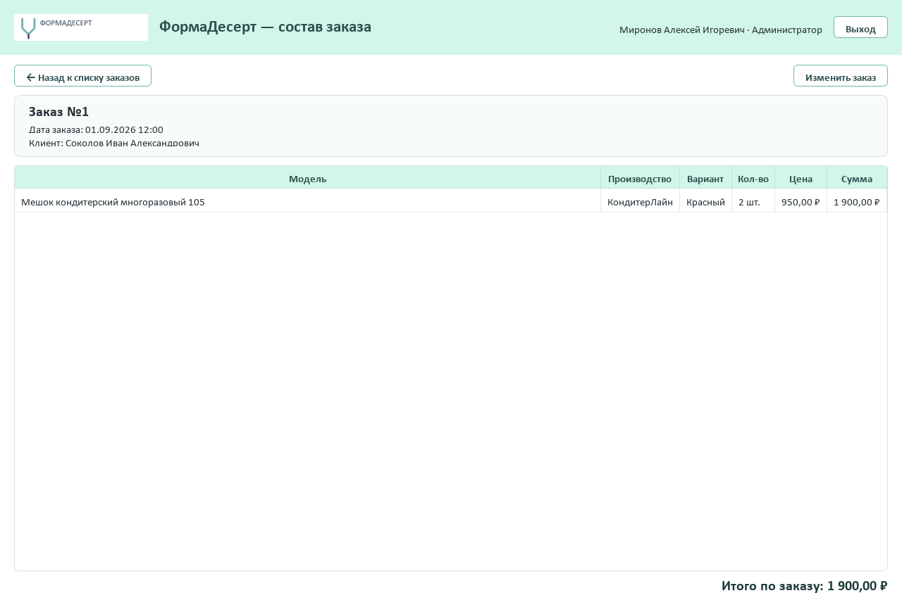

*Рисунок 10. Обновлённый заказ после сохранения изменений.*

---

## 7. Выводы

В ходе выполнения модулей 2–4 реализовано единое приложение «ФормаДесерт»:

* каталог загружается из PostgreSQL и учитывает скидку 25 % по правилу
  предыдущего календарного месяца относительно 20.10.2026;
* интерфейс последовательный, с возвратом назад, поиском, фильтрацией и
  сортировкой в реальном времени;
* заказ оформляется с проверкой остатков и сохраняется в одной транзакции;
* менеджер и администратор работают со списком заказов, составом, созданием,
  удалением и редактированием; остатки возвращаются на склад;
* ошибки ввода, бизнес-логики и БД обрабатываются без аварийного завершения;
* проект собран PyInstaller, снабжён README, SQL-скриптом, ER-диаграммой и
  локальной историей Git.
